<!-- Images in assets/ are rebuilt daily by .github/workflows/profile.yml (scripts/generate.py). -->

  <a href="https://grdzelo.com"><picture><source media="(prefers-color-scheme: dark)" srcset="https://raw.githubusercontent.com/GiorgiGrdzelidze/GiorgiGrdzelidze/main/assets/hero-dark.svg" /></picture></a>
  <a href="https://packagist.org/packages/giorgigrdzelidze/"><picture><source media="(prefers-color-scheme: dark)" srcset="https://raw.githubusercontent.com/GiorgiGrdzelidze/GiorgiGrdzelidze/main/assets/now-dark.svg" /></picture></a>

  <picture><source media="(prefers-color-scheme: dark)" srcset="https://raw.githubusercontent.com/GiorgiGrdzelidze/GiorgiGrdzelidze/main/assets/sec-open-source-dark.svg" /></picture>
  <a href="https://github.com/GiorgiGrdzelidze/laravel-bog-sdk"><picture><source media="(prefers-color-scheme: dark)" srcset="https://raw.githubusercontent.com/GiorgiGrdzelidze/GiorgiGrdzelidze/main/assets/pkg-laravel-bog-sdk-dark.svg" />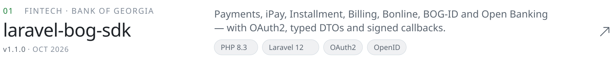</picture></a>
  <a href="https://github.com/GiorgiGrdzelidze/laravel-rsge"><picture><source media="(prefers-color-scheme: dark)" srcset="https://raw.githubusercontent.com/GiorgiGrdzelidze/GiorgiGrdzelidze/main/assets/pkg-laravel-rsge-dark.svg" />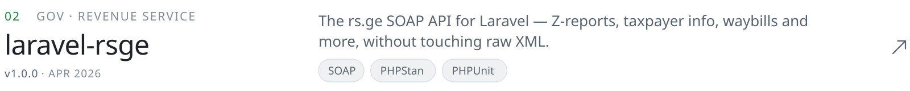</picture></a>
  <a href="https://github.com/GiorgiGrdzelidze/laravel-fina-sdk"><picture><source media="(prefers-color-scheme: dark)" srcset="https://raw.githubusercontent.com/GiorgiGrdzelidze/GiorgiGrdzelidze/main/assets/pkg-laravel-fina-sdk-dark.svg" />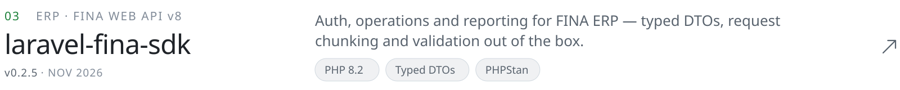</picture></a>
  <a href="https://github.com/GiorgiGrdzelidze/laravel-shopify-sdk"><picture><source media="(prefers-color-scheme: dark)" srcset="https://raw.githubusercontent.com/GiorgiGrdzelidze/GiorgiGrdzelidze/main/assets/pkg-laravel-shopify-sdk-dark.svg" />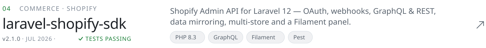</picture></a>
  <a href="https://github.com/GiorgiGrdzelidze/laravel-stringer"><picture><source media="(prefers-color-scheme: dark)" srcset="https://raw.githubusercontent.com/GiorgiGrdzelidze/GiorgiGrdzelidze/main/assets/pkg-laravel-stringer-dark.svg" />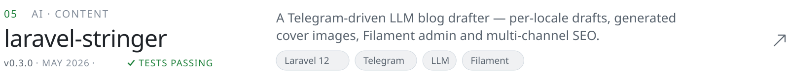</picture></a>
  <a href="https://grdzelo.com"><picture><source media="(prefers-color-scheme: dark)" srcset="https://raw.githubusercontent.com/GiorgiGrdzelidze/GiorgiGrdzelidze/main/assets/pkg-more-dark.svg" />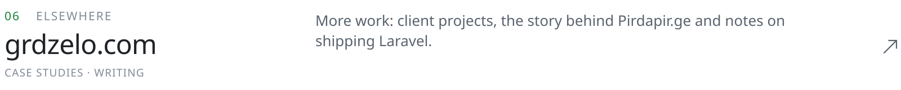</picture></a>
   
  Install any of them with <code>composer require giorgigrdzelidze/&lt;package&gt;</code>

  <picture><source media="(prefers-color-scheme: dark)" srcset="https://raw.githubusercontent.com/GiorgiGrdzelidze/GiorgiGrdzelidze/main/assets/sec-stack-dark.svg" /></picture>
  <picture><source media="(prefers-color-scheme: dark)" srcset="https://skillicons.dev/icons?i=laravel%2Cphp%2Cvue%2Cts%2Creact%2Ctailwind%2Calpinejs%2Cvite%2Cmysql%2Cpostgres%2Credis%2Cdocker%2Cnginx%2Ccloudflare%2Clinux%2Cgit&perline=16&theme=dark" /></picture>
   
  Also: Filament · Livewire · Inertia.js · Pest · PHPUnit · PHPStan · GitHub Actions

  <picture><source media="(prefers-color-scheme: dark)" srcset="https://raw.githubusercontent.com/GiorgiGrdzelidze/GiorgiGrdzelidze/main/assets/sec-contact-dark.svg" /></picture>
  <a href="https://grdzelo.com/en/contact"><picture><source media="(prefers-color-scheme: dark)" srcset="https://raw.githubusercontent.com/GiorgiGrdzelidze/GiorgiGrdzelidze/main/assets/contact-dark.svg" /></picture></a>

  <picture><source media="(prefers-color-scheme: dark)" srcset="https://raw.githubusercontent.com/GiorgiGrdzelidze/GiorgiGrdzelidze/main/assets/sec-links-dark.svg" /></picture>
  <a href="https://grdzelo.com"><picture><source media="(prefers-color-scheme: dark)" srcset="https://raw.githubusercontent.com/GiorgiGrdzelidze/GiorgiGrdzelidze/main/assets/link-site-dark.svg" /></picture></a>
  <a href="mailto:grdzelog@gmail.com"><picture><source media="(prefers-color-scheme: dark)" srcset="https://raw.githubusercontent.com/GiorgiGrdzelidze/GiorgiGrdzelidze/main/assets/link-email-dark.svg" />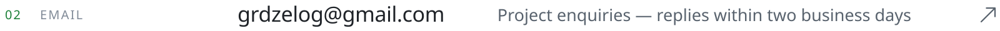</picture></a>
  <a href="https://www.linkedin.com/in/grdzelo/"><picture><source media="(prefers-color-scheme: dark)" srcset="https://raw.githubusercontent.com/GiorgiGrdzelidze/GiorgiGrdzelidze/main/assets/link-linkedin-dark.svg" />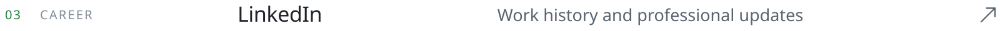</picture></a>
  <a href="https://pirdapir.ge"><picture><source media="(prefers-color-scheme: dark)" srcset="https://raw.githubusercontent.com/GiorgiGrdzelidze/GiorgiGrdzelidze/main/assets/link-pirdapir-dark.svg" /></picture></a>
  <a href="https://packagist.org/packages/giorgigrdzelidze/"><picture><source media="(prefers-color-scheme: dark)" srcset="https://raw.githubusercontent.com/GiorgiGrdzelidze/GiorgiGrdzelidze/main/assets/link-packagist-dark.svg" />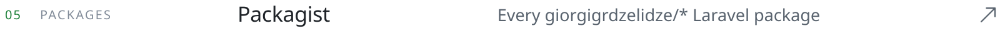</picture></a>
  <a href="https://www.youtube.com/@iamgrdzelo"><picture><source media="(prefers-color-scheme: dark)" srcset="https://raw.githubusercontent.com/GiorgiGrdzelidze/GiorgiGrdzelidze/main/assets/link-youtube-dark.svg" />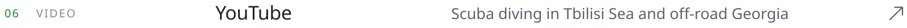</picture></a>
  <a href="https://www.instagram.com/iamgrdzelo"><picture><source media="(prefers-color-scheme: dark)" srcset="https://raw.githubusercontent.com/GiorgiGrdzelidze/GiorgiGrdzelidze/main/assets/link-instagram-dark.svg" />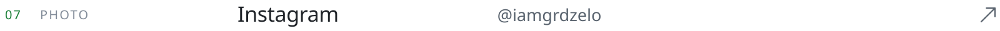</picture></a>
  <a href="https://www.facebook.com/iamgrdzelo"><picture><source media="(prefers-color-scheme: dark)" srcset="https://raw.githubusercontent.com/GiorgiGrdzelidze/GiorgiGrdzelidze/main/assets/link-facebook-dark.svg" /></picture></a>

